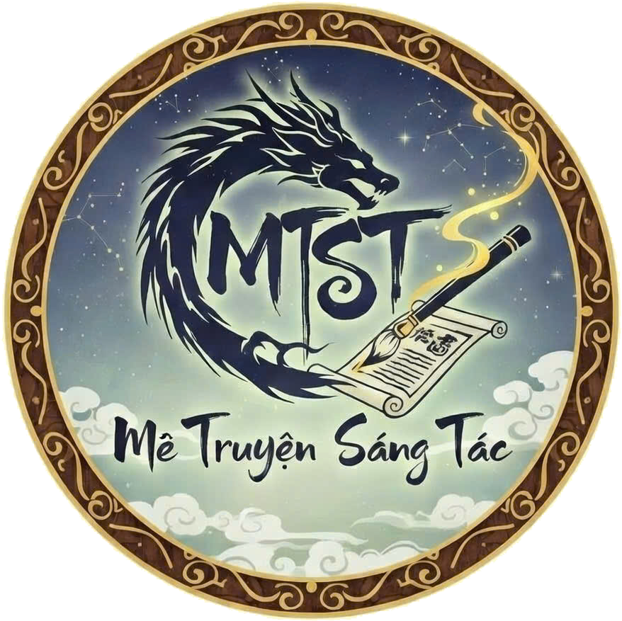

# vBook Extensions Repository — Meo

Kho tiện ích mở rộng (extensions) chất lượng cao dành cho ứng dụng **vBook**.
Hỗ trợ đọc truyện chữ, truyện tranh, xem hoạt hình/anime, dịch thuật AI và đọc văn bản (TTS).

---

<p align="center">
  
</p>

### ☕ Ủng hộ tác giả
Nếu bạn yêu thích các extension của Meo, hãy ủng hộ một ly cà phê để duy trì và phát triển thêm nhiều nguồn mới nhé!

---

## 🚀 1. Cài đặt nhanh trong 30 giây

1. Mở ứng dụng **vBook**
2. Vào mục **Tiện ích mở rộng (Extensions)**
3. Nhấn vào biểu tượng thêm nguồn và dán URL repository:

```text
https://raw.githubusercontent.com/hienpro00123/vbook_MeoU/main/plugin.json
```

4. Chọn extension bạn cần và nhấn **Cài đặt**.

---

## 📚 2. Danh sách Extension (24 tiện ích)

| Icon | Tên Extension | Phân loại | Phiên bản | Nguồn website | Ngôn ngữ |
| :---: | :--- | :---: | :---: | :--- | :---: |
|  | **dualeotruyenfull** | `novel` | v5 | [dualeotruyenfull.net](https://dualeotruyenfull.net) | `vi_VN` |
|  | **LN Kuro** | `novel` | v16 | [lnkuro.top](https://lnkuro.top) | `vi_VN` |
|  | **MeTruyenChu** | `novel` | v17 | [metruyenchu.com.vn](https://metruyenchu.com.vn) | `vi_VN` |
|  | **MeTruyenSangTac** | `novel` | v5 | [metruyensangtac.com](https://metruyensangtac.com) | `vi_VN` |
|  | **Storya** | `novel` | v5 | [storya.click](https://storya.click) | `vi_VN` |
|  | **TrichTinhLau** | `novel` | v8 | [trichtinhlau.com](https://trichtinhlau.com) | `vi_VN` |
|  | **TruyenChu** | `novel` | v9 | [truyenchu.net](https://truyenchu.net) | `vi_VN` |
|  | **Valvrareteam** | `novel` | v10 | [valvrareteam.net](https://valvrareteam.net) | `vi_VN` |
|  | **WanwanSekai -18+** | `novel` | v9 | [wanwansekai.com](https://wanwansekai.com) | `vi_VN` |
|  | **Wattpad - Tiếng Việt** | `novel` | v21 | [www.wattpad.com](https://www.wattpad.com) | `vi` |
|  | **HentaiCube -18+** | `comic` | v1 | [hentaicube.xyz](https://hentaicube.xyz) | `vi_VN` |
|  | **LoppyToon -18+** | `comic` | v18 | [loppytoon.com](https://loppytoon.com) | `vi_VN` |
|  | **nettruyenviet.monster** | `comic` | v4 | [nettruyenviet.monster](https://nettruyenviet.monster) | `vi_VN` |
|  | **OTruyen** | `comic` | v24 | [otruyen.cc](https://otruyen.cc) | `vi_VN` |
|  | **SayHentai -18+** | `comic` | v3 | [sayhentai.cx](https://sayhentai.cx) | `vi_VN` |
|  | **SayHentaiBaby -18+** | `comic` | v13 | [sayhentai.baby](https://sayhentai.baby) | `vi_VN` |
|  | **TruyenDex** | `comic` | v29 | [truyendex.cc](https://truyendex.cc/nettrom) | `vi_VN` |
|  | **Biquge** | `chinese_novel` | v9 | [www.biquge.tw](https://www.biquge.tw) | `zh_CN` |
|  | **Bixiange** | `chinese_novel` | v10 | [m.bixiange.me](https://m.bixiange.me) | `zh_CN` |
|  | **NovelCooksTW** | `chinese_novel` | v9 | [novel.cooks.tw](https://novel.cooks.tw) | `zh_TW` |
|  | **ShiBaShuWu -18+** | `chinese_novel` | v20 | [www.shibashuwu.net](https://www.shibashuwu.net) | `zh_CN` |
|  | **Bilibili TV** | `video` | v2 | [www.bilibili.tv](https://www.bilibili.tv) | `vi_VN` |
|  | **DeepSeek Translate** | `translate` | v6 | [platform.deepseek.com](https://platform.deepseek.com) | `global` |
|  | **Multi TTS VN** | `tts` | v20 | [ai.zalo.solutions](https://ai.zalo.solutions/docs/api/getting-started) | `vi` |

---

## 🛠️ 3. Dành cho Nhà phát triển (Developer & AI Agents)

Kho tiện ích được tổ chức theo chuẩn cấu trúc mới **VBook 3.0**, hỗ trợ đầy đủ các **AI Agent Skills**:

- `.agents/skills/vbook-extensions`: Master spec & runtime constraints (Rhino ES6).
- `.agents/skills/vbook-analyzer`: Phân tích website và bóc tách CSS selector tự động.
- `.agents/skills/vbook-debugger`: Hướng dẫn debug và khắc phục lỗi script.
- `.agents/skills/vbook-publish`: Quy trình build, đóng gói ZIP và cập nhật catalog.

### Lệnh CLI:
```bash
# Tạo extension mới
npm run ext:create -- --name "Tên Extension" --source "https://example.com" --type novel

# Kiểm tra tính tương thích Rhino
node tools/cli/index.js validate --plugin extensions/novel/dualeo

# Đóng gói ZIP
node tools/cli/index.js build --plugin extensions/novel/dualeo

# Rebuild catalog toàn bộ
npm run build:catalog

# Kiểm tra tính toàn vẹn hệ thống
npm run verify
```
